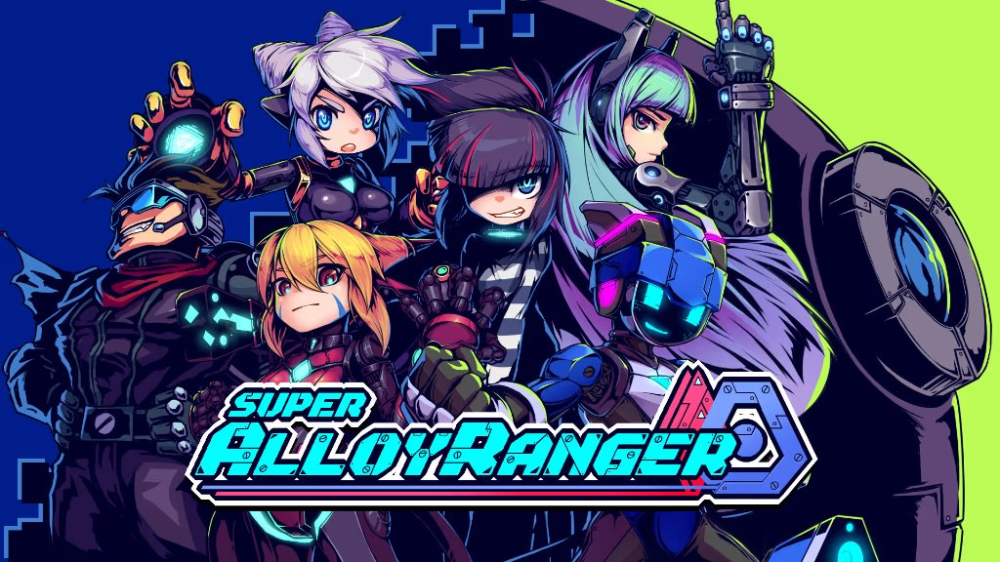

# 🎮 Super Alloy Ranger - Tradução para Português do Brasil (PT-BR)

<p align="center">
  
</p>

<p align="center">
  <b>Tradução completa, nativa e definitiva para Super Alloy Ranger (PC)</b><br>
  Compatível com as versões <b>Steam</b> e <b>Epic Games Store</b> (x64)
</p>

---

## 🌟 Destaques da Tradução

- **100% dos Textos Traduzidos:** História completa, cutscenes, diálogos de NPCs, descrições de armas, equipamentos, missões e conquistas.
- **Legendas de Botões Nativas:** Todos os prompts de comandos nos menus e tutoriais foram traduzidos e adaptados dinamicamente (`Pulo`, `Ataque`, `Voltar`, `Especial`, `Confirmar`, etc.).
- **Ajuste Dinâmico de Layout:** O motor de tradução calcula automaticamente a largura dos botões e afasta as setas de seleção, evitando que textos fiquem cortados ou sobrepostos.
- **Revisão Minuciosa de Lore:** Termos, gírias e pronomes foram revisados e polidos de acordo com o contexto dos personagens (Kelly, Nº 02, Rambos, etc.).
- **Mod Nativo e Ultra Leve:** Sem dependência de ferramentas instáveis como BepInEx ou injeções lentas de OCR/AutoTranslator. Funciona de forma 100% nativa no Unity com desempenho máximo.
- **Instalador Automático com 1 Clique:** Acompanha instalador gráfico com plano de fundo personalizado, detecção automática do jogo e sistema de backup/restauração.

---

## 📦 Como Instalar

### Opção 1: Pelo Instalador Automático (Recomendado)
1. Baixe o executável `Instalador_Traducao_SuperAlloyRanger_PTBR.exe` na aba [Releases](../../releases) ou na pasta `release/`.
2. Abra o instalador.
3. Ele detectará automaticamente a pasta do jogo. (Caso use uma pasta personalizada, clique em **Procurar...**).
4. Clique em **Instalar Tradução**.
5. Pronto! Você já pode clicar em **Jogar Agora** ou abrir o jogo diretamente pela Steam / Epic Games.

### Opção 2: Instalação Manual (Arquivo ZIP)
1. Baixe o arquivo `SuperAlloyRanger_Traducao_PTBR.zip`.
2. Extraia o conteúdo e copie a pasta `Super.Alloy.Ranger_Data` para a pasta raiz do seu jogo (onde fica o `Super.Alloy.Ranger.exe`).
3. Substitua os arquivos quando o Windows solicitar.
4. Inicie o jogo normalmente.

---

## 🔄 Como Desinstalar / Restaurar o Jogo Original

- **Pelo Instalador:** Abra o instalador e clique no botão **Restaurar Original**. O backup original será restaurado instantaneamente com 1 clique.
- **Pela Steam / Epic Games:** Basta solicitar a "Verificação de integridade dos arquivos" no inicializador da plataforma.

---

## 🛠️ Estrutura do Repositório

```text
├── assets/
│   ├── app_icon.ico           # Ícone oficial do jogo
│   └── installer_bg.jpg       # Arte visual do instalador
├── release/
│   ├── Instalador_Traducao_SuperAlloyRanger_PTBR.exe
│   └── SuperAlloyRanger_Traducao_PTBR.zip
├── src/
│   ├── SARTranslator.cs       # Código-fonte da DLL de tradução nativa
│   ├── Installer.cs           # Código-fonte do instalador gráfico (WinForms)
│   └── patch_all.ps1          # Script de injeção IL (Mono.Cecil)
├── translation_ptbr.txt       # Dicionário de tradução completo (870+ entradas)
├── translation_ptbr.json      # Dicionário em formato JSON
├── LEIA-ME.txt                # Instruções rápidas em texto puro
└── README.md                  # Este documento
```

---

## 📜 Licença e Créditos

- Jogo original desenvolvido por **Alloy-K Studio** e publicado pela **Gamera Games**.
- Tradução e engenharia reversa por **Antigravity**.
- Tradução feita de fã para fãs, sem fins lucrativos. Apoie os desenvolvedores adquirindo o jogo original!
